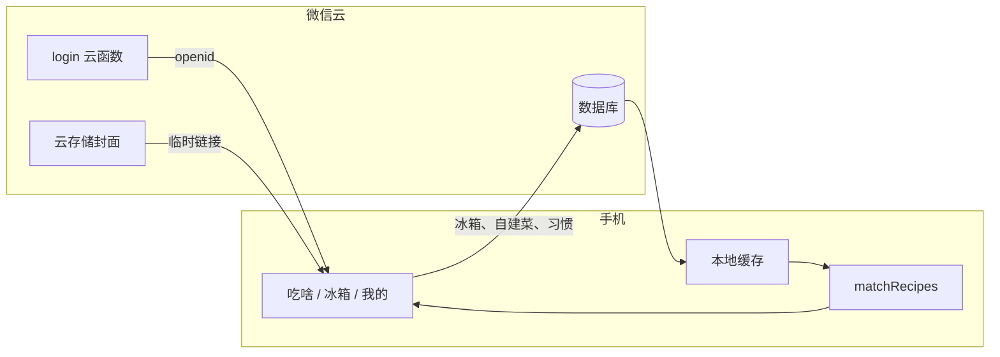

# 今晚吃甚么

微信小程序「今晚吃甚么」已经上线。根据冰箱里已有的食材，筛选今晚能做的家常菜，以及还差一两样的菜。可以记下自己的菜谱。

后端是微信云开发：云数据库、云存储和只返回 openid 的云函数 `login`。封面图存在云存储里，页面通过微信云接口换成临时链接再显示。因此只有微信小程序能完整看到官方菜的封面。H5 使用同一套页面和匹配，但不会初始化微信云，官方封面保持亚麻色块，登录也只是本机匿名 id。

一套 UniApp Vue 3 + TypeScript 代码，可以同时跑微信小程序和 H5。官方菜谱文字来自[程序员做饭指南](https://github.com/Anduin2017/HowToCook)（Unlicense）。封面是生成的配图，不是菜谱原图。没有点餐、外卖、下单，也不做智能生成。

## 功能

- **冰箱**：按组勾选已有食材。可以添加自定义食材。清空只去掉勾选，食材名字还在。
- **吃啥**：空冰箱时提示「先去冰箱勾食材」。有勾选时分成「今晚能做」和「还差」。
- **搜索**：按菜名或食材名在全部官方菜和我的菜里找，不看冰箱里有没有。找不到时显示「没有找到这道菜」。
- **详情**：已有和还缺的食材、用量、步骤。步骤里的强调会加粗。出处可复制链接。
- **我的**：当天的冰箱变化、看过的菜、写下的菜。新建、编辑和删除自建菜谱在吃啥页。
- **封面**：微信小程序里，官方菜有云端配图时显示方图，没有编号时是亚麻色块。自建菜谱用菜谱图标作默认封面。H5 不显示云端封面。

## 技术栈

| | |
|---|---|
| 端 | UniApp Vue 3、TypeScript、Vite |
| 测试 | Vitest |
| 后端 | 微信云开发：数据库、云存储、一个云函数。封面只在小程序内完整显示 |
| 包管理 | pnpm，Node 20 |

匹配在手机上算。云函数只有 `login`，只返回 openid。

## 本地运行

```bash
pnpm install
pnpm dev:h5          # 浏览器
pnpm dev:mp-weixin   # 微信小程序，不是 dev:wx
pnpm test
pnpm type-check
pnpm build:mp-weixin # 正式包，输出 dist/build/mp-weixin
```

微信开发者工具导入 `dist/dev/mp-weixin`。云函数源码在仓库的 `cloudfunctions/login`，部署时把云函数目录指到这里，用「上传并部署：云端安装依赖」。不要把这个目录打进小程序包，也不要再部署第二个函数。

`src/cloud/env.ts` 的 `CLOUD_ENV_ID` 已经填了当前使用的微信云环境。把它改成空字符串后，微信端不再请求云，页面用包里的种子数据。H5 即使填了环境 ID，也不调用 `wx.cloud`，登录用本机匿名 id，云存储里的封面也不会出现。

## 架构

官方菜和食材的主数据在微信云。手机拉下来之后在本地匹配，改一道菜不用发版。



`#ifdef` 只出现在 `src/cloud/auth.ts`：微信里初始化云并调用 `login`；H5 生成本地匿名 id。

`data/recipes.json` 和 `data/ingredients.json` 是导入云数据库的来源，也是测试夹具。云可用时，运行时以云上的文档为准，这两份 JSON 不再当主数据。云失败、而且缓存和内存都空时，才用种子把列表填上。

## 页面

`src/pages.json`：

| 位置 | 页面 |
|---|---|
| 主包，底部三个标签 | 吃啥、冰箱、我的 |
| 主包 | 编辑菜谱 |
| 分包 | 菜谱详情、隐私说明 |

吃啥页会预载详情分包。我的页会预载详情和隐私说明。

吃啥列表在手机上是两列。窗口窄于约 300px 时一列，不窄于 768px 时四列。导航和标签栏是 `#E8E0C8`，页面底是亚麻色 `#F4F1DE`。

## 匹配

`matchRecipes`（`src/utils/match.ts`）只看菜谱的 `need`：

- 缺 0 样，进「今晚能做」。
- 缺 1 或 2 样，并且冰箱里已经有这道菜的至少一样食材，进「还差」。
- 缺 3 样及以上、`need` 为空、或冰箱里一样都没有的菜，不出现。

同一组里，缺得更少的在前；缺的样数相同，则用料更短的在前；再相同，官方菜在自建菜前面；最后按中文菜名。

空冰箱不在这个函数里特殊处理。`useMatch` 在没有勾选时不调用它，吃啥页显示「先去冰箱勾食材」。两边都没有菜时显示「没有能做或只差一两样的菜」。

搜索框有字时，不走上面的分流。范围是全部官方菜和我的菜，菜名或食材名包含关键字即可。菜名命中的排在前面。卡片上的「缺」仍按当前冰箱计算，只用于展示。

吃啥页还可以按菜谱目录筛选：荤菜、素菜、水产、主食、汤羹、早餐、甜品、饮品、调味、半成品。自建菜归在「我的」。

## 冰箱与自建菜

官方食材编号以 `o_` 开头，按组排列：蔬菜、肉类、水产、蛋奶豆、主食、干货坚果、水果、调味。自定义食材编号是 `c_` 加 8 位小写字母或数字，单独放在「自定义」。去掉首尾空格后的同名自定义食材不会再插一条。

自建菜谱保存在 `my_recipes`，`source` 为 `mine`，用 `ownerId` 限制本人。官方菜读出来一律标成 `official`，库里的文档可以不存 `source`。

## 云数据库

集合和安全规则在微信云控制台配置，不写进代码。控制台导入和云函数不受这些规则限制。

| 集合 | 谁能读写 | 端上 |
|---|---|---|
| `ingredients` | 登录可读 | 只读。食材 `id`、`name`、`group` |
| `recipes` | 登录可读 | 只读。菜谱可以没有 `source` |
| `covers` | 登录可读 | 只读。字段只有菜谱 `id` 和云存储 `fileID` |
| `fridges` | 文档 `_id` 等于当前 openid | 勾选 `have` 和自定义食材 `custom` |
| `journals` | 文档 `_id` 等于当前 openid | 习惯记录 `events` |
| `my_recipes` | `ownerId` 等于当前 openid | 自建菜的增删改 |

导入用 JSON Lines（一行一个对象，扩展名仍是 `.json`）。不要直接导入仓库里的 JSON 数组，也不要和封面 jpg 一起导入。单次读取最多 20 条，`fetchAll` 会翻页。

## 缓存与未同步

打开页面先读本机缓存，再在后台刷新。拉取失败不把旧缓存盖成空。

冰箱、自建菜和习惯记录都先写本机，失败不回滚。还没配置云环境时，只留在本机，不提示。已经配置了云、但登录失败或写入失败时，勾选和记录保持原样，并 toast「未同步」。

本机缓存键：`eat.recipes`、`eat.ingredients`、`eat.fridge`、`eat.myRecipes`、`eat.detail`、`eat.journal`。H5 另有 `eat.anonId`。微信和 H5 的存储互不相通。

## 封面

345 张 jpg 在微信云存储的 `covers/` 目录，文件名是菜谱 `id`。`fileID` 只写在 `covers` 集合里，不写进 `data/recipes.json`，也不放进主包。

吃啥页用 `wx.cloud.getTempFileURL` 把编号换成 https 临时链接，再交给卡片。这个接口只在微信小程序里存在，所以完整封面只在已上线的小程序中显示。换不到链接时卡片保持亚麻色块，不把 `cloud://` 直接塞进图片地址。云存储需要允许当前小程序用户读取这些文件，临时链接才会成功。自建菜谱没有云端封面，卡片和列表用菜谱图标代替。H5 始终是亚麻色块。

## 目录

```text
cloudfunctions/login/   只返回 openid 的云函数
data/                   官方食材和菜谱，导入源与测试夹具
src/cloud/              环境 ID、登录、数据库读写
src/components/         菜谱卡片、食材分组、空状态等
src/composables/        冰箱、菜谱、匹配、习惯记录
src/pages/              吃啥、冰箱、我的、详情、隐私
src/utils/              matchRecipes、封面编号、缓存、习惯汇总
```

## 测试

```bash
pnpm test
pnpm exec vitest run src/utils/match.spec.ts
```

`matchRecipes` 的分流由单测锁住。封面编号、习惯汇总、行内强调也有对应的 `*.spec.ts`。

## 许可

应用代码版权所有 © 2026 7king1joker，以 [MIT](LICENSE) 许可发布。

官方菜谱的正文、步骤和用量来自[程序员做饭指南](https://github.com/Anduin2017/HowToCook)（Unlicense，公有领域），不随本仓库改成 MIT。封面是 Nano Banana 生成的配图，不是菜谱原图，也不使用 HowToCook 的照片。

## 设计取舍

基于 UniApp Vue3 + TypeScript 的 C 端小程序「今晚吃甚么」，已在微信上线。后端是微信云开发。一套代码也能打开 H5，但 H5 不走微信云，封面不会完整显示。根据已有食材筛选能做及还差 1～2 样的家常菜；官方菜谱云端可改、匹配在端上计算。

1. 官方菜谱在云库并有本地缓存，私人冰箱上云。匹配不走云函数，改菜不用发版。
2. `matchRecipes` 按缺 0 / 1～2 / ≥3 分流，单测锁住规则。
3. 拉取失败用缓存；写云失败本地保留；浅色界面把点选和两组列表做成可以录屏的样子。
